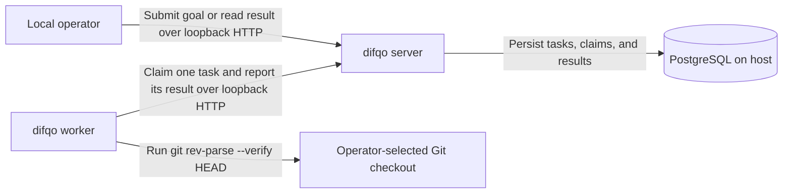
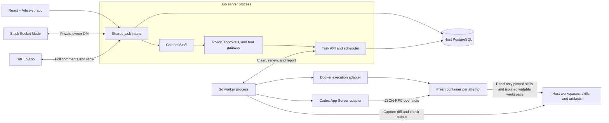

# Difqo architecture

## Implemented local task flow

The local operator starts the server and starts a worker with a checkout path. The
worker claims one queued task and runs a fixed Git revision check. The task goal
is stored as text. Task status is derived from the attempt record. An absent
attempt means queued, an incomplete attempt means claimed, and a completed
attempt carries the result. Reposting the same result is safe. If a worker
stops after claiming, the recorded attempt stays incomplete.

The server uses an unauthenticated loopback API for the groundwork. Run it
in a trusted local development environment. PostgreSQL stores the revision check
output directly. The development workflow and API examples are in the [local
setup guide](development.md).

## MVP target

The control plane owns configuration, policy, approvals, and durable task
history. The worker manages execution and reports evidence through the task API.
Attempt leases, isolated workspaces, and host-backed evidence are the planned
recovery boundary. The Mac mini proof of concept will verify container
authentication, recovery after interruption, and host restart behavior after
the execution and recovery code is implemented.

See [ADR 0001](adr/0001-local-first-mvp-stack.md) for the tradeoffs behind this
layout.
