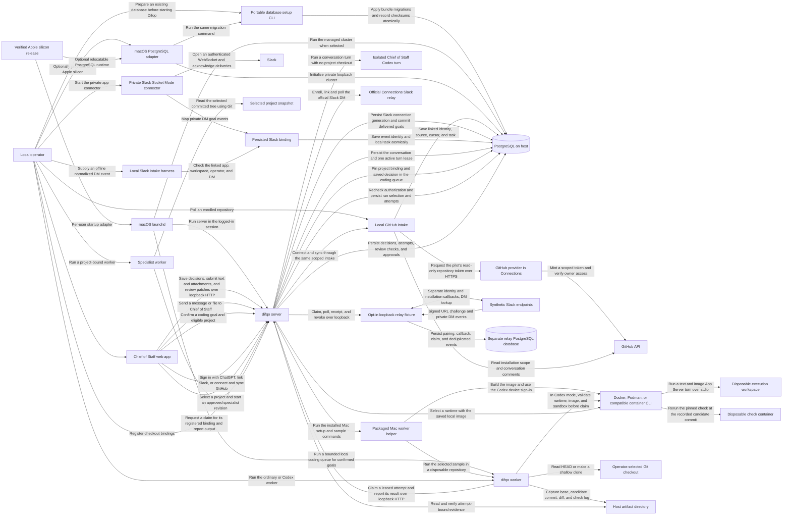
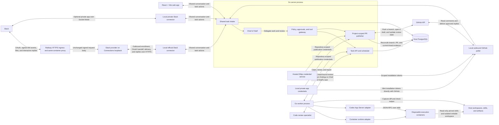

# Difqo architecture

## Implemented local task flow

The local operator starts the server and starts a worker with a checkout path.
The default worker claims one task and runs a fixed Git revision check. Codex
mode selects one usable container CLI before claiming work, runs one turn in
a disposable workspace, renews the lease, and
captures the patch and operator-configured check output on the host. A task
whose credentials require sign-in is marked blocked. See
[ADR 0003](adr/0003-bounded-codex-execution.md) and
[ADR 0006](adr/0006-local-container-runtime-selection.md). The task API returns the latest
attempt and derives its status in PostgreSQL. A task starts queued, becomes
claimed while its lease is active, and finishes when a result is recorded. The API supports lease
renewal. If a worker stops, the next worker can reclaim the task after expiry
with a new attempt ID. The task is exhausted after three expired attempts.
Reposting the same completed result is safe, and expired attempts cannot report
results. See [ADR 0002](adr/0002-worker-attempt-leases.md).

The server uses an unauthenticated loopback API for the groundwork. Run it
in a trusted local development environment. PostgreSQL stores the revision check
output directly. The development workflow and API examples are in the [local
setup guide](development.md).

The official GitHub intake pilot requests a scoped installation token from
Connections and polls GitHub directly. Connections checks the configured
operator's current repository access before releasing the token. Manual
intake can also use a pre-issued installation token.
Imported tasks use the same decision and patch-review flow as local goals.
Workers opt into that repository's queue by numeric ID. See
[ADR 0007](adr/0007-github-intake.md) and [ADR 0015](adr/0015-official-github-pilot.md).

Private Slack app intake connects outbound over Socket Mode and maps direct
messages to the same local binding used by the offline harness. Accepted
goals commit before acknowledgement. The official app remains the planned
default through a relay that can reuse the local intake rules. See
[ADR 0009](adr/0009-local-slack-intake.md).

The installed CLI verifies connectivity to the operator-selected PostgreSQL
database and applies the bundled migrations and their history in one
transaction. On Apple silicon, the release adapter uses a bundled or operator-supplied
PostgreSQL 18 binary directory to provision a private loopback cluster and
calls the same CLI to set up the database. See
[ADR 0011](adr/0011-portable-database-setup.md).

The installed macOS service adapter registers per-user jobs and checks
readiness through the loopback task API. It preserves external database
configuration without registering a local database job. See
[ADR 0013](adr/0013-macos-launch-agents.md).

## Chief of Staff web app

The Go server can serve the built React app and API on the same loopback origin.
The installed Mac's main composer sends text and files to a one-to-one Chief of
Staff conversation. The local API persists each turn and its reply in
PostgreSQL. Codex receives recent completed turns as context in an isolated,
empty workspace. Chief of Staff can ask about files sent on their own. The
existing coding goal action in Project tools uses task intake. The browser mixes
saved conversation turns and coding goals by creation time, polls for state
changes, and expands available worker artifacts in a project file.
The project file links to patch review. Goals capture the latest saved
decision revision at submission. For a captured patch, the review shows that
decision, the original base, the checked candidate, the patch digest, and the
check command and logs. The server checks out the recorded candidate commit
for reruns in a disposable container. Older attempts reconstruct the base
and digest-verified patch. PostgreSQL records approval for the
attempt and its latest passing rerun. The reviewed patch is available for
manual application. See [ADR 0005](adr/0005-exact-patch-review.md).

See [ADR 0004](adr/0004-local-web-app.md) and the
[local web setup](development.md#chief-of-staff-web-app).

## Specialist configuration

The operator registers local Git checkout bindings at server startup and
reviews specialist proposals in the Chief of Staff conversation. PostgreSQL
stores the proposal, decision and immutable approved configuration. Each
configuration has one bounded profile and an explicit project set. The Go
server checks eligibility against current bindings and policy. Approval and
disable actions are transactional and need no worker.

A specialist run pins the approved revision, project binding, and that
project's saved decision. A bound worker rechecks the current authorization
at claim time and uses local Git reads to produce its snapshot report.
The conversation shows attempts and failures from the run's project file.
See [ADR 0005](adr/0005-specialist-configuration.md) and
[ADR 0008](adr/0008-project-bound-specialist-runs.md).

## MVP target

The control plane owns configuration, policy, approvals, and durable task
history. The worker manages execution and reports evidence through the task API.
Attempt leases protect the task result. Isolated workspaces and host-backed
evidence keep the patch and check output available after container removal.
The Mac mini proof of concept will verify authentication, recovery after
interruption, and host restart behavior.

See [ADR 0001](adr/0001-local-first-mvp-stack.md) for the tradeoffs behind this
layout.

The proposed official Slack connection separates workspace installation from
linking the operator's private DM. The local service connects outbound to the
relay and remains authoritative for tasks and approvals.
[Official Slack Connect design](adr/0010-official-slack-connect.md)

For projects with GitHub delivery enabled, Chief of Staff's target result is a
pull request with verification and independent review on its current head.
Chief of Staff assigns the code review specialist, receives findings on the
original task, and coordinates fixes and re-review. The local web app and
optional Slack DM expose the same conversation and task actions. Local-only
projects and exceptions use the local review path.
See [ADR 0014](adr/0014-chief-of-staff-pr-delivery.md).
