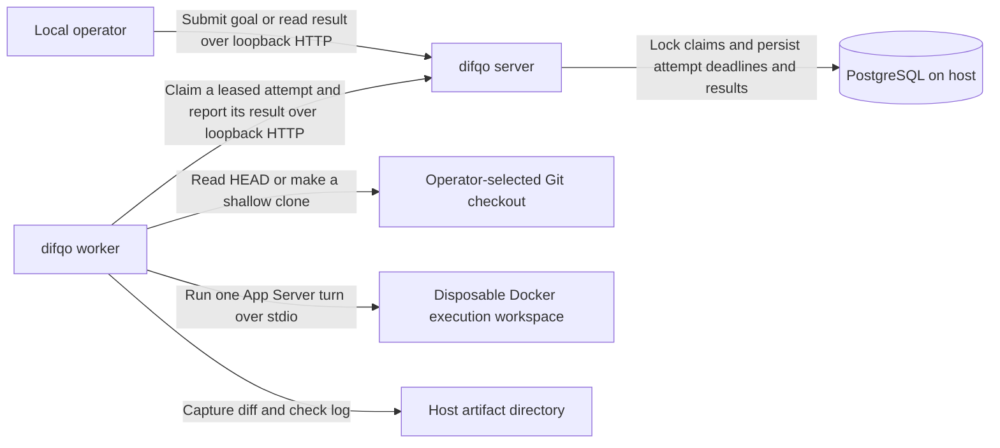
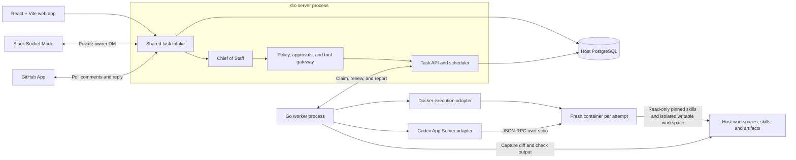

# Difqo architecture

## Implemented local task flow

The local operator starts the server and starts a worker with a checkout path.
The default worker claims one task and runs a fixed Git revision check. Codex
mode runs one turn in a disposable Docker workspace, renews the lease, and
captures the patch and operator-configured check output on the host. A task
whose credentials require sign-in is marked blocked. See
[ADR 0003](adr/0003-bounded-codex-execution.md). The task API returns the latest
attempt and derives its status in PostgreSQL. A task starts queued, becomes
claimed while its lease is active, and finishes when a result is recorded. The API supports lease
renewal. If a worker stops, the next worker can reclaim the task after expiry
with a new attempt ID. The task is exhausted after three expired attempts.
Reposting the same completed result is safe, and expired attempts cannot report
results. See [ADR 0002](adr/0002-worker-attempt-leases.md).

The server uses an unauthenticated loopback API for the groundwork. Run it
in a trusted local development environment. PostgreSQL stores the revision check
output directly. The development workflow and API examples are in the [local
setup guide](development.md).

## Chief of Staff frontend demo

The React and Vite app in `web/` runs the installation, readiness, and
conversation flows with synthetic browser-local state. It renders sample
goals, evidence, and approval requests in the Chief of Staff conversation.
The control plane and worker diagram above describes the separate, real task
execution path. See the [frontend development workflow](development.md#chief-of-staff-frontend-demo).

## MVP target

The control plane owns configuration, policy, approvals, and durable task
history. The worker manages execution and reports evidence through the task API.
Attempt leases protect the task result. Isolated workspaces and host-backed
evidence keep the patch and check output available after container removal.
The Mac mini proof of concept will verify authentication, recovery after
interruption, and host restart behavior.

See [ADR 0001](adr/0001-local-first-mvp-stack.md) for the tradeoffs behind this
layout.
