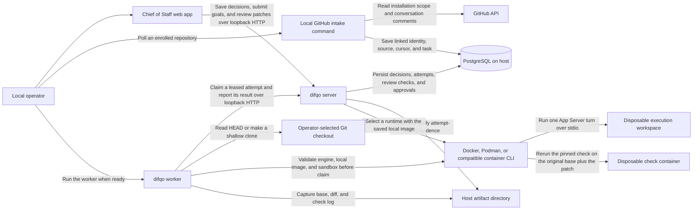
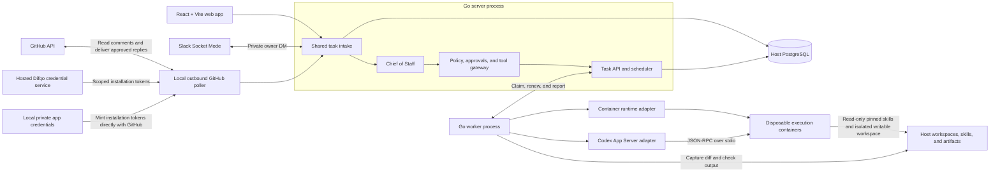

# Difqo architecture

## Implemented local task flow

The local operator starts the server and starts a worker with a checkout path.
The default worker claims one task and runs a fixed Git revision check. Codex
mode selects one usable container CLI before claiming work, runs one turn in
a disposable workspace, renews the lease, and
captures the patch and operator-configured check output on the host. A task
whose credentials require sign-in is marked blocked. See
[ADR 0003](adr/0003-bounded-codex-execution.md) and
[ADR 0006](adr/0006-local-container-runtime-selection.md). The task API returns the latest
attempt and derives its status in PostgreSQL. A task starts queued, becomes
claimed while its lease is active, and finishes when a result is recorded. The API supports lease
renewal. If a worker stops, the next worker can reclaim the task after expiry
with a new attempt ID. The task is exhausted after three expired attempts.
Reposting the same completed result is safe, and expired attempts cannot report
results. See [ADR 0002](adr/0002-worker-attempt-leases.md).

The server uses an unauthenticated loopback API for the groundwork. Run it
in a trusted local development environment. PostgreSQL stores the revision check
output directly. The development workflow and API examples are in the [local
setup guide](development.md).

The GitHub intake command uses a pre-issued installation token scoped to a
repository and accepts task requests from the locally configured GitHub user.
Imported tasks use the same decision and patch-review flow as local goals.
Workers opt into that repository's queue by numeric ID. See
[ADR 0007](adr/0007-github-intake.md).

## Chief of Staff web app

The Go server can serve the built React app and API on the same loopback origin.
The conversation is reconstructed from the 100 newest saved goals and their
latest attempts. Submitting a goal uses the existing task intake. The browser
polls for state changes and expands available worker artifacts in a project file.
The project file links to patch review. Goals capture the latest saved
decision revision at submission. For a captured patch, the review shows that
decision, the original base, the patch digest, and the check command and logs.
The server reruns the check in a disposable container reconstructed from the
captured base and digest-verified patch. PostgreSQL records approval for the
attempt and its latest passing rerun. The reviewed patch is available for
manual application. See [ADR 0005](adr/0005-exact-patch-review.md).

See [ADR 0004](adr/0004-local-web-app.md) and the
[local web setup](development.md#chief-of-staff-web-app).

## Specialist configuration

The operator registers local Git checkout bindings at server startup and
reviews specialist proposals in the Chief of Staff conversation. PostgreSQL
stores the proposal, decision and immutable approved configuration. Each
configuration has one bounded profile and an explicit project set. The Go
server checks eligibility against current bindings and policy. Approval and
disable actions are transactional and need no worker.

Specialist runs in [#20](https://github.com/nep-ai/difqo/issues/20) will select
one eligible project per run and enforce its isolation boundary. See
[ADR 0005](adr/0005-specialist-configuration.md).

## MVP target

The control plane owns configuration, policy, approvals, and durable task
history. The worker manages execution and reports evidence through the task API.
Attempt leases protect the task result. Isolated workspaces and host-backed
evidence keep the patch and check output available after container removal.
The Mac mini proof of concept will verify authentication, recovery after
interruption, and host restart behavior.

See [ADR 0001](adr/0001-local-first-mvp-stack.md) for the tradeoffs behind this
layout.
